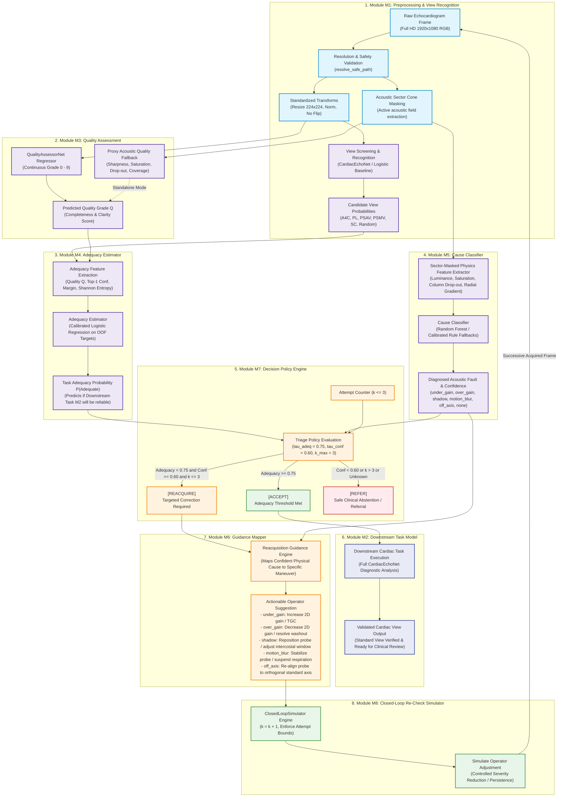

# SelfCheckUltrasound: ImageQuality-Aware Diagnosis and Reacquisition Guidance

[](https://www.python.org/downloads/)
[](https://pytorch.org/)
[](https://creativecommons.org/licenses/by/4.0/)
[]()
[]()

A Python research prototype and machine learning framework for cardiac ultrasound (echocardiography). The system connects **image quality assessment**, **task-specific adequacy estimation**, **cause-aware reacquisition guidance**, and **closed-loop simulation** to support ultrasound acquisition quality control.

---

## 1. Project Scope & Ethical Boundary

- **Organ & Modality:** Exclusively **cardiac ultrasound (echocardiography / echo)**.
- **Data Origin:** Acquired on a **CAE Blue Phantom** echocardiography training phantom with a **GE M4S Matrix Probe** on a **GE Healthcare Vivid-Q ultrasound machine**.
- **Clinical Boundary:** This is an engineering research prototype and decision-support simulation. It is **not** an autonomous medical device, does **not** perform clinical disease diagnosis (the phantom contains anatomical structures, not human pathologies), and contains **no** protected health information (PHI).
- **Environment:** Pure local Python package with reproducible CLI execution, automated unit testing, and structured file outputs. No web servers or web applications.

---

## 2. Dataset Overview: CACTUS

This project utilizes the **CACTUS** open dataset ([Elmekki et al., 2025](https://doi.org/10.1016/j.compbiomed.2025.110003)):
- **Total Images:** 37,736 images (Full HD 1920 × 1080, RGB format).
- **Cardiac Views (6 Classes):**
  1. `A4C` — Apical Four Chamber (7,422 images)
  2. `PL` — Parasternal Long Axis (6,102 images)
  3. `PSAV` — Parasternal Short Axis – Aortic Valve (5,832 images)
  4. `PSMV` — Parasternal Short Axis – Mitral Valve (6,014 images)
  5. `SC` — Subcostal Four Chamber (6,345 images)
  6. `Random` — Non-standard / Uninterpretable / Out-of-plane scans (6,021 images)
- **Expert Quality Grades:** Every image has a ground-truth score (0–9 scale) assigned by cardiovascular imaging experts evaluating **completeness** (visibility of target cardiac structures) and **clarity** (luminosity, speckle purity, SNR).
- **Sequence Metadata:** Filenames encode ultrasound acquisition tags: depth (`D14`–`D17`), dynamic range (`DR2`–`DR7`), video sequence (`V1`–`V5`, `Folder1`–`Folder5`), and sequential frame indices.

---

## 3. System Architecture & Modular Pipeline (M1–M8)

The system is organized into eight modular, decoupled subsystems (**M1–M8**) coordinating deep learning view classification, continuous quality estimation, out-of-fold task adequacy prediction, sector-masked physical fault diagnosis, actionable operator guidance, and confidence-gated policy triage.

### 3.1 The 8-Module Architectural Matrix

| Module | Core Responsibility | Model / Component | Inputs & Outputs |
| :--- | :--- | :--- | :--- |
| **M1. Preprocessing & View Recognition** | Validate images, enforce safety bounds, and identify supported cardiac views. | `resolve_safe_path`, `SectorExtractor`, `transforms.py`, `CardiacEchoNet` / Spatial Logistic | **Input:** Raw Full HD RGB frame (1920x1080x3)<br/>**Output:** Standardized tensor (224x224), sector mask, candidate view distribution |
| **M2. Downstream Task Model** | Perform a defined, label-supported cardiac analysis task on accepted images. | `CardiacEchoNet` (4-stage CNN, ~370k parameters) | **Input:** Validated echocardiogram tensor meeting adequacy threshold<br/>**Output:** Standardized cardiac view classification (`A4C`, `PL`, `PSAV`, `PSMV`, `SC`) and downstream analytical features |
| **M3. Quality Assessment** | Estimate continuous image quality grade using expert annotations or proxy features. | `QualityAssessorNet` (CNN regressor) / `_proxy_quality` (physics fallback) | **Input:** Standardized tensor or 7 sector-masked physics features<br/>**Output:** Continuous scalar quality grade Q in [0.0, 9.0] |
| **M4. Adequacy Estimator** | Predict downstream task error or whether task execution falls within defined clinical tolerance. | `AdequacyEstimator` (calibrated logistic regressor on out-of-fold validation targets) | **Input:** Quality score Q, Top-1 confidence, Top-2 margin, predictive Shannon entropy H<br/>**Output:** Task adequacy probability P(Adequate) in [0.0, 1.0] |
| **M5. Cause Classifier** | Identify supported image-quality root causes and report diagnosis confidence. | `CauseClassifier` (Random Forest on sector-masked physics features + rule fallbacks) | **Input:** 7 sector-masked physics features (luminance, saturation, sharpness, drop-out, coverage)<br/>**Output:** Diagnosed fault (under_gain, over_gain, shadow, motion_blur, off_axis, none) & confidence score |
| **M6. Guidance Mapper** | Map sufficiently confident, supported causes to candidate reacquisition suggestions. | `ReacquisitionPolicy.SUGGESTIONS` mapping engine | **Input:** Diagnosed acoustic fault with confidence >= 0.60<br/>**Output:** Actionable probe / ultrasound machine manipulation instructions |
| **M7. Decision Policy** | Choose accept, reacquire, or refer based on validated thresholds and confidence. | `ReacquisitionPolicy.evaluate` | **Input:** P(Adequate), diagnosed fault, fault confidence, attempt counter k<br/>**Output:** Three-way guarded triage: `[ACCEPT]`, `[REACQUIRE]`, or `[REFER]` |
| **M8. Re-Check Loop** | Evaluate successive simulated images, enforce attempt bounds, and stop safely. | `ClosedLoopSimulator` (leakage-free closed-loop execution engine) | **Input:** Base image, initial fault, operator recovery model (severity step = 0.5)<br/>**Output:** Full simulation trajectory and audit telemetry |

---

### 3.2 End-to-End Decision Flow



---

### 3.3 Package File Organization

```
Self_Check_Ultrasound/
├── self_check_ultrasound/
│   ├── config.py                  # Central configuration (paths, seeds, policy thresholds)
│   ├── data/
│   │   ├── manifest.py            # Dataset discovery & metadata parser (all 37,736 files)
│   │   ├── splits.py              # Sequence-aware group-stratified splitting & coverage check
│   │   ├── transforms.py          # M1: Preprocessing transforms (no horizontal flips)
│   │   ├── degradations.py        # M8: Calibrated image-space fault generators (6 modes)
│   │   └── dataset.py             # M1: PyTorch Dataset loader with path-traversal protection
│   ├── models/
│   │   ├── view_classifier.py     # M1 / M2: View recognition & downstream task (CardiacEchoNet)
│   │   ├── quality_assessor.py    # M3: Expert quality grade regression (QualityAssessorNet)
│   │   ├── adequacy_estimator.py  # M4: Task adequacy prediction (calibrated & heuristic)
│   │   └── cause_classifier.py    # M5: Sector-masked acoustic fault classifier
│   ├── guidance/
│   │   ├── reacquisition_policy.py# M6 / M7: Guidance mapper & triage decision policy engine
│   │   └── simulator.py           # M8: Closed-Loop re-check simulator (leakage-free)
│   ├── visualization/
│   │   └── plots.py               # Publication-grade figures & style tokens (300 DPI)
│   └── utils/
│       ├── seed.py                # Deterministic seed controller (random, numpy, torch)
│       ├── metrics.py             # Balanced accuracy, Macro F1, QWK, Pearson r, ECE
│       ├── paths.py               # Safe path traversal verification (is_relative_to)
│       └── eval_utils.py          # Bootstrap 95% CIs and paired difference tests
├── scripts/
│   ├── build_manifest.py          # Generates dataset_manifest.csv & leakage-free splits.csv
│   ├── train_view_baseline.py     # M1/M2: Trains & evaluates view baselines on TEST with bootstrap CIs
│   ├── train_quality_baseline.py  # M3: Trains & evaluates quality baselines on TEST with bootstrap CIs
│   ├── train_adequacy.py          # M4: Fits task-specific adequacy on out-of-fold validation targets
│   ├── evaluate_cause_classifier.py # M5: Evaluates cause classifier on held-out synthetic & real grades
│   ├── run_simulation.py          # M8: Executes canonical closed-loop reacquisition trajectories
│   ├── interactive_demo.py        # Interactive CLI demo for testing individual echo frames
│   └── generate_research_plots.py # Generates Figures 1-5 in artifacts/figures/
├── tests/                         # Comprehensive 56-test automated suite (100% pass)
└── requirements.txt               # Lower-bounded Python dependencies
```

---

## 4. Key Methodological Contributions

### 4.1 Sequence-Aware Leakage Prevention & Coverage Check
Consecutive video frames in echocardiography (e.g., `frame_1088` and `frame_1089`) are visually near-identical. A naive random split leads to severe data leakage. Our `splits.py` module groups images by `(view, sequence_group, machine_param)` and applies balanced bin-packing to ensure:
- **Zero Sequence Leakage:** The pairwise sequence-group intersection across Train, Validation, and Test is strictly empty (zero overlap).
- **Split Proportions:** Train: 24,070 images (63.8%), Validation: 7,228 images (19.2%), Test: 6,438 images (17.1%).
- **Coverage Check:** `check_split_coverage()` validates that every view class has non-empty representation across all three partitions.

### 4.2 Controlled Image-Space Degradations
To evaluate cause-aware reacquisition guidance in a controlled setting, `degradations.py` provides calibrated image-space proxy fault modes with severity scaling (severity in [0.1, 1.0]):
1. `under_gain`: Acoustic attenuation / insufficient gain (I' = alpha * I).
2. `over_gain`: Acoustic blooming / signal blowout.
3. `acoustic_shadow`: Vertical column drop-out simulating rib / calcification shadows.
4. `motion_blur`: Transducer jitter and respiratory motion blur.
5. `off_axis`: Anatomical misalignment via sector cropping / zoom.
6. `none`: Reference image.

*Note: These are controlled image-space approximations rather than full wave-equation acoustic simulations.*

---

## 5. Empirical Baseline Results (Held-Out TEST Split)

All baseline evaluations are reported on the untouched **held-out TEST split** using **95% percentile bootstrap confidence intervals**:

### View Classification (Module M1)
Comparison between classical spatial feature baseline and `CardiacEchoNet` (4-stage CNN, ~370k parameters):

| Metric | Classical (Spatial + Logistic) | CardiacEchoNet (CNN) | Paired Difference [95% CI] |
| :--- | :---: | :---: | :---: |
| **Accuracy** | **0.713** [0.663, 0.763] | 0.370 [0.313, 0.420] | -0.343 [-0.407, -0.277] |
| **Macro F1-Score** | **0.688** [0.636, 0.734] | 0.258 [0.223, 0.291] | -0.430 [-0.490, -0.366] |
| **ECE (Calibration)** | **0.107** | 0.292 | — |

*Training uses mild rotation without horizontal flipping, preserving standard anatomical cardiac chamber orientation.*

### Quality Assessment (Module M3)
Continuous regression against expert completeness/clarity grades (0–9 scale):

| Metric | Naive Baseline (Mean = 3.99) | QualityAssessorNet (Best Val Checkpoint) |
| :--- | :---: | :---: |
| **Mean Absolute Error (MAE)** | 2.250 [2.100, 2.407] | **2.168** [2.033, 2.322] |
| **Root Mean Squared Error (RMSE)** | 2.638 [2.513, 2.769] | **2.555** [2.409, 2.706] |
| **Pearson Correlation (r)** | 0.000 | **0.411** [0.332, 0.485] |
| **Quadratic Weighted Kappa (QWK)** | 0.000 | **0.138** |

---

## 6. Installation & Quick Start

### 1. Clone & Setup Environment
```powershell
git clone https://github.com/AniveshGuptaOfficial/Self_Check_Ultrasound.git
cd Self_Check_Ultrasound

# Install dependencies
python -m pip install -r requirements.txt
```

### 2. Generate Manifest & Sequence Splits
```powershell
# Fast metadata indexing
python scripts/build_manifest.py

# Optional: full image decoding and corruption validation across all 37,736 files
python scripts/build_manifest.py --validate
```

### 3. Run Automated Test Suite
```powershell
python -m pytest -v tests/
```
*(Runs **56 automated unit tests** verifying data loaders, splits, coverage, degradations, models, metrics, paths, and security with 100% pass rate).*

### 4. Train Models & Decision Modules
```powershell
# Train view recognition baseline (M1)
python scripts/train_view_baseline.py

# Train quality assessment baseline (M3)
python scripts/train_quality_baseline.py

# Fit task adequacy estimator on out-of-fold validation targets (M4)
python scripts/train_adequacy.py

# Evaluate sector-masked cause classifier (M5)
python scripts/evaluate_cause_classifier.py
```

### 5. Run Closed-Loop Simulator & Interactive Demos
```powershell
# Run the 5 canonical closed-loop reacquisition trajectories (M8)
python scripts/run_simulation.py

# Run interactive demo on any echocardiogram with custom simulated faults
python scripts/interactive_demo.py --fault under_gain --severity 0.70

# Generate all 5 publication figures (300 DPI)
python scripts/generate_research_plots.py
```

---

## 7. Security & Reproducibility Audit

- **Dependency Security:** Audited with `pip-audit`: **0 known vulnerabilities**. Dependencies use lower bounds (`package>=x.y.z`) for environment flexibility.
- **Path Traversal Defense:** `resolve_safe_path()` in `utils/paths.py` uses `Path.is_relative_to` on fully resolved paths, rejecting sibling-prefix attacks and path escapes.
- **Safe Model Deserialization:** State dicts are strictly loaded with `weights_only=True` to eliminate arbitrary code execution hazards.
- **Reproducibility:** Seed determinism (`seed=42`) verified across PyTorch, NumPy, and Python standard libraries.

---

## 8. Citation & Attribution

If you use this codebase or the CACTUS dataset in your research, please cite:

```bibtex
@article{DBLP:journals/cbm/ElmekkiASSZZBKXPMOSM25,
  author       = {Hanae Elmekki and Ahmed Alagha and Hani Sami and Amanda Spilkin and
                  Antonela Zanuttini and Ehsan Zakeri and Jamal Bentahar and Lyes Kadem and
                  Wen{-}Fang Xie and Philippe Pibarot and Rabeb Mizouni and Hadi Otrok and
                  Shakti Singh and Azzam Mourad},
  title        = {{CACTUS:} An open dataset and framework for automated Cardiac Assessment
                  and Classification of Ultrasound images using deep transfer learning},
  journal      = {Comput. Biol. Medicine},
  volume       = {190},
  pages        = {110003},
  year         = {2025},
  doi          = {10.1016/J.COMPBIOMED.2025.110003}
}
```

---

## 9. License

This repository is distributed under the [CC BY 4.0 License](https://creativecommons.org/licenses/by/4.0/) in accordance with the underlying CACTUS dataset distribution (academic attribution to Elmekki et al., 2025).
